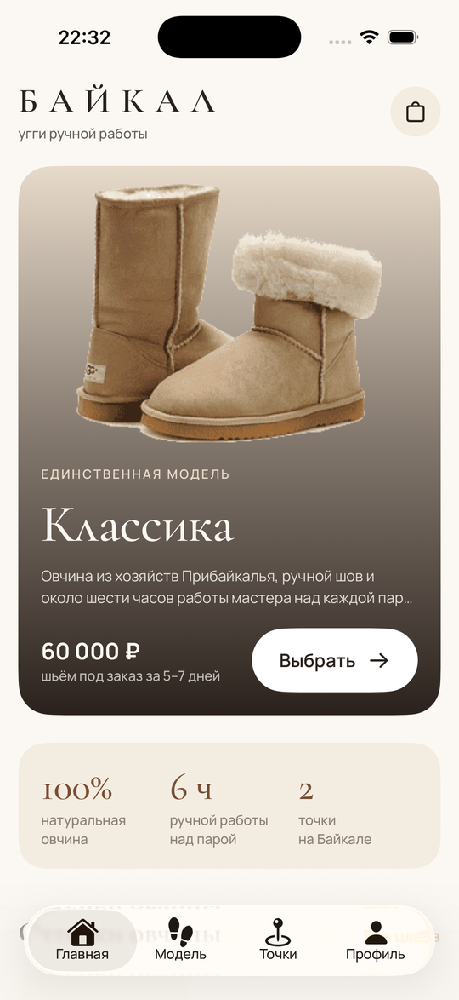
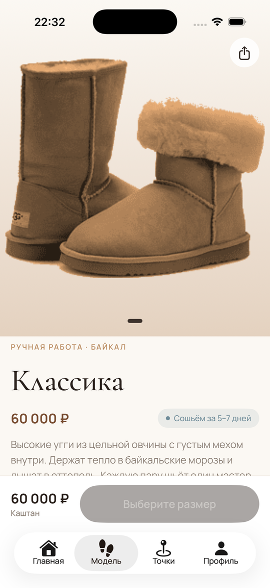
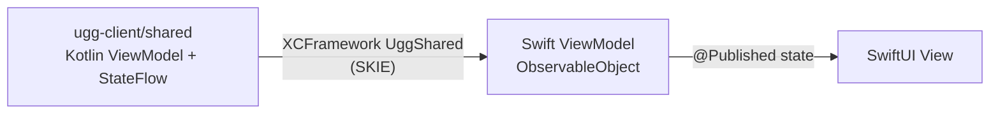

# UGG Store — iOS-клиент на SwiftUI

Нативный iOS-клиент интернет-магазина обуви. UI написан на SwiftUI, а бизнес-логика и ViewModel'и
общие с Android и Web: они приходят из Kotlin Multiplatform-модуля [ugg-client](https://github.com/DinarBes/ugg-client)
в виде XCFramework `UggShared`. Pet-проект.

<!-- Скриншоты: положите картинки в docs/screenshots/ и раскомментируйте строку ниже -->
<!--    -->

## Как устроена связка Kotlin ↔ Swift



- Kotlin-ViewModel берётся из DI общего модуля (`app.di.careViewModel()`)
- Её `StateFlow` через SKIE превращается в Combine-publisher и маппится в Swift-структуру состояния
- SwiftUI-экран видит обычный `ObservableObject` и ничего не знает о Kotlin

Так вся логика (запросы, кэш, авторизация, корзина) пишется и тестируется один раз в Kotlin, а UI остаётся полностью нативным.

## Структура

Локальный Swift Package `ugg-kit` с 13 модулями-фичами: Core, Firebase, Auth, Splash, Onboarding,
Home, Product, Cart, Stores, Profile, Care, Story, Navigation.
Внутри каждой фичи — слои `Data` (маппинг DTO из Kotlin), `Domain` (состояния) и `Presentation`
(ViewModel и View с разделением на `External` / `Internal`).

## Стек

Swift 6 · SwiftUI · Combine · Swift Package Manager · Swinject · Firebase iOS SDK · MapKit · Kotlin Multiplatform (XCFramework) · SKIE

## Запуск

1. Склонируйте [ugg-client](https://github.com/DinarBes/ugg-client) так, чтобы он лежал по пути
   `../../multiplatform/ugg-client` относительно папки этого репозитория (так прописано в `ugg-kit/Package.swift`).
2. Соберите XCFramework:
   ```bash
   cd ugg-client
   ./gradlew :shared:assembleUggSharedDebugXCFramework
   ```
3. Откройте `ugg-apple.xcodeproj` в Xcode и запустите схему `ugg-apple`.

## Связанные репозитории

- [ugg-client](https://github.com/DinarBes/ugg-client) — KMP-модуль, Android- и Web-клиенты
- [ugg-admin](https://github.com/DinarBes/ugg-admin) — Android-приложение для управления магазином

## Автор

Динар Павлов — Android / KMP-разработчик · Telegram [@sapore_mare](https://t.me/sapore_mare)
